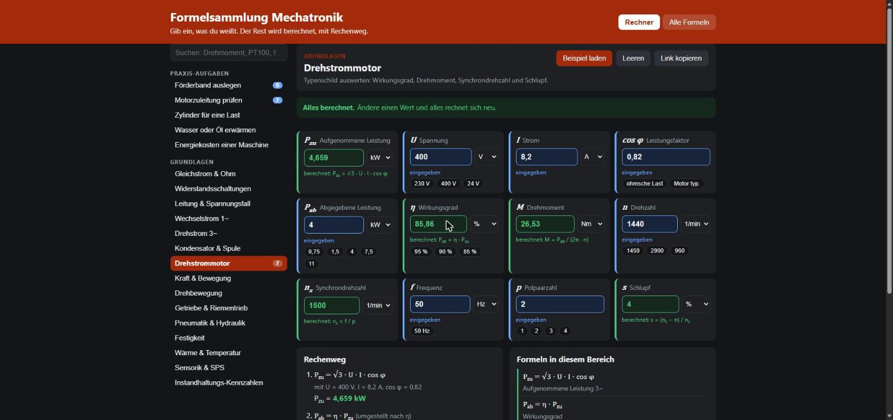

# 📐 Formelsammlung Mechatronik

Eine interaktive Formelsammlung für Mechatroniker, Elektroniker, Techniker und Ingenieure. Läuft im Browser und auf dem Handy, ohne Installation.

**👉 Live:** https://tobias-hauser.github.io/formelsammlung/



## Die Idee

Im Tabellenbuch sucht man erst die richtige Formel, stellt sie dann um und rechnet oft mehrere Formeln hintereinander. Hier geht es andersherum:

**Gib ein, was du weißt. Der Rest wird berechnet, mit Rechenweg.**

- ✍️ Werte in **beliebige Felder** eintragen, die Reihenfolge ist egal
- 🔁 Jede Formel wird **automatisch umgestellt**, nach jeder Größe
- 🔗 Formeln werden **verkettet**: Aus Typenschild-Daten folgen Wirkungsgrad, Drehmoment und Schlupf in einem Rutsch
- 🧾 **Rechenweg** Schritt für Schritt, mit eingesetzten Werten
- 💡 **Tipp**, welcher Wert als Nächstes am meisten freischaltet
- ⚠️ **Widerspruchsprüfung**, wenn eingegebene Werte nicht zusammenpassen
- 📏 **Einheiten** pro Feld umschaltbar (W/kW, 1/min, bar, mm², …)
- 🔗 **Link teilen**: Die Rechnung steckt in der Adresse

## Inhalt

**157 Formeln in 36 Bereichen.**

**Praxis-Aufgaben** (mehrere Bereiche kombiniert)

| Aufgabe | Was herauskommt |
|---|---|
| Förderband auslegen | Reibkraft, Leistung, Übersetzung, Momente an Trommel und Motor |
| Motorzuleitung prüfen | Strom, Spannungsfall in V und %, Leitungsverluste |
| Abschaltbedingung prüfen | Abschaltstrom, max. Schleifenimpedanz, Ausnutzung am Leitungsende |
| Zylinder für eine Last | Nötiger Kolbendurchmesser, Luftverbrauch |
| Wasser oder Öl erwärmen | Aufheizzeit, Energie, Kosten |
| Energiekosten einer Maschine | kWh und € pro Jahr |
| Lohnt sich ein Effizienzmotor? | Ersparnis pro Jahr, Amortisationszeit |

**Grundlagen**

| Gebiet | Bereiche |
|---|---|
| Elektrotechnik | Gleichstrom & Ohm · Widerstandsschaltungen · Leitung & Spannungsfall · Wechselstrom 1~ · Drehstrom 3~ · Stern & Dreieck · Blindstromkompensation · Kondensator & Spule (mit Ladekurve) · Schwingkreis & RLC · Transformator · LED & Gleichrichter · Drehstrommotor |
| Mechanik | Kraft & Bewegung · Beschleunigte Bewegung · Hebel, Flaschenzug, schiefe Ebene, Feder · Drehbewegung · Massenträgheit & Hochlauf · Getriebe & Riementrieb · Zahnrad & Gewindespindel · Festigkeit · Biegung, Torsion, Pressung · Zerspanung & Gewinde |
| Fluidtechnik & Wärme | Pneumatik & Hydraulik · Hydraulikpumpe & Druckluft · Wärme & Temperatur |
| Automatisierung | Sensorik & SPS (4…20 mA, 0…10 V, S7-Analogwert, PT100/PT1000, Drehgeber) · Regelungstechnik (P-Regler, PT1) |
| Instandhaltung | Kennzahlen (MTBF, MTTR, Verfügbarkeit, OEE) · Wälzlager-Lebensdauer L10h |

Unter **„Alle Formeln“** gibt es die komplette Sammlung zum Durchsuchen und Ausdrucken.

## Wie es funktioniert

Jede Formel ist einmal hinterlegt, z. B. `P = √3 · U · I · cos φ`. Ein kleiner Löser sucht immer wieder nach Formeln, in denen nur noch **eine** Größe fehlt:

- Fehlt die linke Seite, wird direkt gerechnet.
- Fehlt eine Größe auf der rechten Seite, wird numerisch umgestellt (Nullstellensuche mit Bisektion).
- Jeder neue Wert kann weitere Formeln lösbar machen, bis nichts mehr geht.

Intern wird alles in SI-Einheiten gerechnet. Reines HTML, CSS und JavaScript, keine Frameworks.

```
formeln.js   Größen, Einheiten, Formeln, Bereiche und der Löser
app.js       Oberfläche
style.css    Design (hell und dunkel)
```

Eine neue Formel braucht nur eine Zeile:

```js
fx('ohm', 'Ohmsches Gesetz', 'U = R · I', 'U', ['R', 'I'], v => v.R * v.I);
```

---

Entwickelt von **Tobias Hauser**, Mechatroniker (IHK) aus Freiburg, mit KI-Unterstützung.
Richtwerte ohne Gewähr, im Zweifel gilt das Tabellenbuch.
